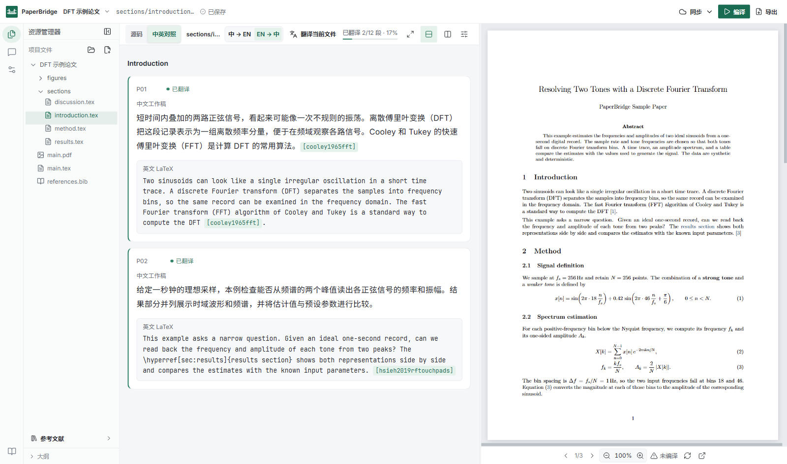

# PaperBridge

PaperBridge 是一个运行在 Windows 本地的中英文 LaTeX 论文修改工具。

它适合需要反复修改英文论文、但更习惯先用中文组织和调整内容的研究者。使用时可以修改中文工作稿，由 AI 更新对应的英文 LaTeX，并随时在 PDF 预览中检查英文版本的实际排版。英文 LaTeX 始终是最终排版依据，因此页数变化、公式或引用异常、段落换页，以及图片和表格位置变化都能及时发现。

PaperBridge 不代替作者决定论文内容。它用于保持中文修改、英文表达和 LaTeX 排版之间的对应关系，让多轮修改更容易检查和管理。




## 主要功能

1. **翻译维护**：导入 ZIP 或本地项目时，自动排除导言区、作者信息、宏定义、公式、图表、算法代码和参考文献等非翻译内容；按段落维护中文工作稿和英文 LaTeX，只翻译指定段落或章节。
2. **版本维护**：支持 Overleaf Git，以及 GitHub、GitLab 等 HTTPS Git 仓库的拉取和推送；支持 OpenAI 兼容接口、DeepSeek、Anthropic 和 Gemini，并可分别配置翻译模型与编译诊断模型。

## 安装

Windows 桌面版是当前主线。请在 [GitHub Releases](https://github.com/liyunjie-phd/PaperBridge/releases) 中选择名称以 `windows-v` 开头的 release 下载；Windows 的开发和发布优先级最高。

### 三条产品线的版本

PBLaTex 插件、Windows 桌面版和 macOS 桌面版各自维护版本号，不再共用一个 `v*` 版本。当前版本记录在 [product-versions.json](product-versions.json) 中：

| 产品线 | 当前版本 | 发布 tag 前缀 | 说明 |
| --- | --- | --- | --- |
| Windows | 0.5.1 | `windows-v` | 主线，优先更新和发布 |
| macOS | 0.1.0 | `macos-v` | 独立的 DMG / ZIP 构建 |
| PBLaTex | 0.1.0 | `pblatex-v` | VS Code 增强插件 |

例如，Windows 发布使用 `windows-v0.5.1`，macOS 发布使用 `macos-v0.1.1`；一个产品线的版本更新不会改变其他产品线的版本。构建前可运行 `npm run versions:check` 检查版本是否一致，使用 `npm run versions:set -- <product> <version>` 更新指定产品线。

本次版本新增参考文献工作台：可以通过 DOI、doi.org 链接或论文网页自动生成 BibTeX，自动建议 `author_year_keyword` 形式的 citation key，识别重复文献，并在写入前预览和修改 BibTeX。工作台也支持搜索、查看字段解释以及直接插入正文引用。

Windows 提供两种安装包：`PaperBridge-with-Git-Setup.exe` 是完整版，内置 Git 和 Tectonic；`PaperBridge-Setup.exe` 是精简版，不内置 Git，但保留 Tectonic。两种版本都不需要另行安装 Node.js。电脑已经安装 TeX Live 或 MiKTeX，并且可以使用 `latexmk` 时，PaperBridge 会优先使用本机 LaTeX；否则自动使用内置 Tectonic。

安装时可以选择程序安装目录。首次启动时还可以单独选择数据目录，用于保存设置、中文工作稿、源码备份和导入的论文项目，数据目录之后也可以在设置中迁移到其他磁盘。

当前版本没有商业代码签名证书。Windows 首次运行时可能显示“Windows 已保护你的电脑”。确认安装包来源后，可以选择 **更多信息 > 仍要运行**。

可以从 Windows 的 **设置 > 应用 > 已安装的应用** 中卸载 PaperBridge。卸载时可以选择保留数据，也可以删除 PaperBridge 数据目录中的项目、工作稿、备份、设置和缓存。

## 基础配置

### 1. 选择论文来源

首次启动时可以选择四种来源：

| 来源 | 适用情况 | 需要填写或选择 |
| --- | --- | --- |
| Overleaf | 账户和项目已经开通 Overleaf Git | 项目链接、Overleaf Git Token |
| Git 仓库 | 论文已经保存在 GitHub 或 GitLab | HTTPS 仓库地址；私有仓库还需要用户名和 Token |
| ZIP 文件 | 从 Overleaf 下载项目，或没有 Overleaf Git 权限 | 本地 `.zip` 文件 |
| 本地文件夹 | 论文已经保存在电脑中 | 本地 LaTeX 项目目录 |

ZIP 和本地文件夹可以选择同时连接一个 GitHub 或 GitLab 仓库。导入时只建立连接，不会立即上传；首次推送前会显示完整文件清单，默认只选择 TeX、Bib、样式文件和图片等论文文件。

如果项目中存在多个带 `\documentclass` 的完整 TeX 文件，PaperBridge 会要求选择主文件。应选择与 Overleaf 菜单中 **Main document** 相同的文件，不能只根据文件是否叫 `main.tex` 判断。之后可以在设置中切换主 TeX 文件，也可以通过左侧“文档”旁的文件夹加号切换论文项目。

### 2. 配置 Overleaf Git

Overleaf Git 集成通常需要个人订阅、团队订阅或学校提供的 Overleaf Commons 权限。可以在项目左侧的 **Integrations > Git** 中确认是否已经开通，详细说明见 [Overleaf Git integration](https://docs.overleaf.com/integrations-and-add-ons/git-integration-and-github-synchronization/git-integration)。

获取 Git Token：

1. 登录 Overleaf。
2. 打开 [Overleaf Account Settings](https://cn.overleaf.com/user/settings)。
3. 找到 **Git integration authentication tokens**。
4. 生成新的 Token，并填入 PaperBridge 的 **Overleaf Git Token**。

PaperBridge 会在本机加密保存 Token，并在拉取和推送时自动使用，不需要再输入 Git 密码。Token 与密码具有相同的访问能力，请不要截图、上传或发送给他人。

如果出现 `no git access`、`repository not found` 或“项目没有 Git 访问权限”，常见原因是项目链接错误、项目不存在、当前账户没有项目权限，或者项目没有开通 Overleaf Git。没有该功能时，可以从 Overleaf 下载 ZIP 后导入。

### 3. 配置 AI 接口

PaperBridge 支持 OpenAI 兼容接口、Anthropic Messages 和 Gemini GenerateContent。首次配置会将同一接口用于段落翻译和编译诊断，之后可以在设置中分别调整。

以 DeepSeek 为例：

1. 登录 [DeepSeek 开放平台](https://platform.deepseek.com/)。
2. 在 [API Keys](https://platform.deepseek.com/api_keys) 创建 API Key。
3. 在 [Usage](https://platform.deepseek.com/usage) 查看余额和用量。
4. 在 PaperBridge 中选择 DeepSeek / OpenAI 兼容接口，填写 Base URL 和 API Key，然后点击 **测试连接**。

| 设置项 | 示例 |
| --- | --- |
| API 服务类型 | `DeepSeek / OpenAI 兼容接口` |
| 模型 | 从下拉框选择，或使用接口提供方要求的自定义模型名 |
| Base URL | `https://api.deepseek.com` |
| API Key | 在 DeepSeek 开放平台创建的 Key |

API Key 只应保存在自己的电脑中，不要提交到 GitHub，也不要随论文项目发送给他人。

### 4. 配置 GitHub 或 GitLab

PaperBridge 目前支持 HTTPS 仓库，不支持 SSH 地址。公开仓库可以不填写 Token；私有仓库需要 Git 用户名和 Personal Access Token。Token 在 Windows 本地加密保存，不会写入论文目录或 Git 远端地址。

如果远端仓库已有内容，PaperBridge 仍可以直接推送本地 ZIP 或文件夹项目：同名文件以当前本地版本更新，远端独有文件保留，不会生成重复路径。首次推送仍会显示文件清单，需确认要上传的论文文件。

## 日常论文修改工作流

1. **导入并检查项目**：选择论文来源和主 TeX 文件，先确认项目可以正常编译并显示 PDF。
2. **准备中文工作稿**：选择当前 TeX 文件中的章节批量生成中文，或者只点击某个段落的语言按钮。已有中文的段落不会重复调用接口。
3. **逐段修改**：在左侧修改中文，点击右箭头只更新当前段落的英文 LaTeX。也可以新增或删除段落，或者直接修改右侧英文。
   翻译和英文编辑会按用户输入直接写入 LaTeX，不再因为命令、引用、公式或标记的新增、删除、变更而拦截；语法问题统一在编译时显示。
4. **随时检查排版**：以右侧 PDF 为准检查页数、换页、公式、引用、图片和表格位置。双击 PDF 文字可以返回对应段落；找不到翻译段落时会打开 TeX 源码。
5. **处理简单源码问题**：进入 **TeX** 页面编辑当前项目引用的 `.tex` 和 `.bib` 文件，使用 `Ctrl+S` 保存并重新编译。每个源码文件最多保留最近 3 份备份。
6. **处理编译错误**：打开右侧编译信息，查看 AI 给出的文件、行号、原因和建议；点击位置后人工确认并修改源码。相同错误会复用本地诊断缓存。
7. **同步与交付**：确认 PDF 后导出文件；使用 Overleaf 或普通 Git 仓库时，再执行拉取、检查和推送。

## 数据位置与隐私

- PaperBridge 在 Windows 本地运行并编译 LaTeX。
- 只有翻译、编译诊断或格式分析所需的文字会发送给用户配置的 AI API。
- 编译诊断只发送错误日志、报错行附近源码和必要的 LaTeX 配置，不发送无关的完整正文。
- API Key、Overleaf Git Token 和 GitHub/GitLab Token 在桌面版本中通过 Windows 安全存储加密。
- 中文工作稿和源码备份位于 PaperBridge 数据目录，不写入英文论文的 Git 仓库。
- 中文工作稿按项目串行保存，使用临时文件原子替换并保留最近备份。
- TeX / Bib 源码同样串行保存并原子替换；参与编辑的符号链接会被拒绝。
- 上传未公开论文前，应确认所使用 AI 服务的数据处理和隐私政策符合所在单位要求。

## 常见问题

### Overleaf 无法拉取

先确认项目链接、项目权限和 Overleaf Git 订阅状态。没有 Git 权限时，从 Overleaf 下载 ZIP 后导入。

### `Command \algorithm already defined`

先确认选择了正确的主 TeX 文件，再检查是否同时加载了 `algorithm`、`algorithm2e` 等定义同名环境的宏包。PaperBridge 不会自动删除论文宏包。

### 有编译警告但 PDF 可以生成

普通警告不会阻止 PDF 预览。只有导致编译失败、无法得到可用 PDF 的致命错误才会阻止更新预览。

### Windows 阻止安装程序

当前安装包没有商业代码签名证书。请先确认下载来源，再通过 **更多信息 > 仍要运行** 继续。学校或公司电脑可能通过安全策略禁止未签名软件，应遵守所在单位的规定。

### `AI provider returned 401: Authentication Fails`

DeepSeek 将 401 定义为 API Key 认证失败。PaperBridge 的“段落翻译”和“编译错误诊断”可以使用不同接口，因此应在设置中分别确认两处都显示 **已保存 API Key**，再点击对应的测试按钮。仍然失败时，请在 DeepSeek 开放平台重新创建 Key，并确认没有把 Base URL 误填到 API Key 输入框。

## 本地开发

```powershell
npm install
npm test
npm run desktop
```

生成 Windows 完整安装版：

```powershell
npm run build:windows
```

生成不内置 Git 的 Windows 精简版：

```powershell
npm run build:windows:slim
```

## macOS 版本

PaperBridge 也提供 macOS 构建版本，支持 Intel (`x64`) 和 Apple Silicon (`arm64`)。Mac 版本使用 `.dmg` 安装包，并在构建时随包附带对应架构的 Tectonic，不需要另外安装 Node.js 或 Git。

### 从 GitHub Actions 构建

在 GitHub 仓库的 **Actions > Build PaperBridge for macOS > Run workflow** 中手动启动构建。完成后，在对应的 workflow run 页面下载 `PaperBridge-mac-x64` 或 `PaperBridge-mac-arm64` artifact，其中包含 DMG 和 ZIP。

推送 `macos-v*` 格式的 tag 可以自动触发 macOS 构建；Windows 的构建由 `windows-v*` tag 单独触发。当前构建未配置 Apple Developer 签名和公证；首次打开时如果 macOS 提示无法验证开发者，请在 Finder 中右键应用选择“打开”，或在“系统设置 > 隐私与安全性”中允许打开。

### 在 Mac 上本地构建

需要 macOS、Node.js 22、Homebrew 和 Xcode Command Line Tools：

```bash
npm ci
brew install tectonic
ARCH="$(node -p 'process.arch')"
mkdir -p "resources/bin/darwin-$ARCH"
cp "$(brew --prefix tectonic)/bin/tectonic" "resources/bin/darwin-$ARCH/tectonic"
chmod +x "resources/bin/darwin-$ARCH/tectonic"
if [ "$ARCH" = "arm64" ]; then npm run build:mac:arm64; else npm run build:mac:x64; fi
```

生成的文件位于 `release/macos/`；Windows 构建产物位于 `release/windows/`。如果 Mac 已经安装 TeX Live 或 MiKTeX，也可以不放入 Tectonic，PaperBridge 会优先使用系统的 `latexmk`。
